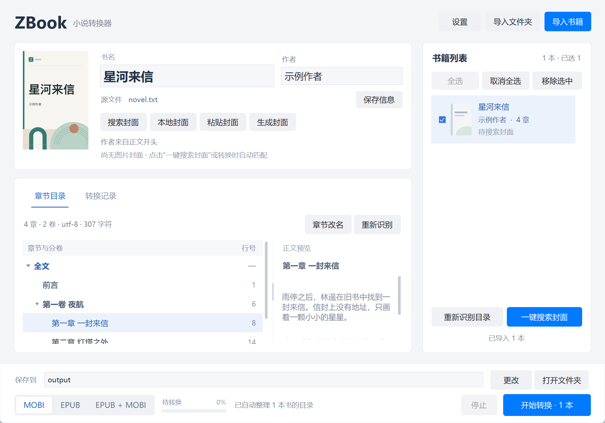

# ZBook 小说转换器

把小说文档整理成适合电纸书阅读的 EPUB 和 MOBI。

**版本：1.0.0 · 作者：[huoranxuanyuan](AUTHORS.md) · Windows 10/11 x64 · [AGPL-3.0-only](LICENSE)**

## 能做什么

- 导入 TXT、Word DOC/DOCX、RTF 和文字型 PDF，自动识别书名、作者、章节与分卷。
- 批量搜索并应用封面，在书籍列表中直接查看缩略图，支持逐本调整。
- 使用本地图片、剪贴板图片，或生成适合彩色和黑白电纸书的大字封面。
- 导出 EPUB、MOBI，或同时导出两种格式；默认选择 MOBI。
- 每批最多 50 本，同名输出自动编号，保留已生成的电子书。

## 开始使用

在本仓库的 **Releases** 下载 `ZBook-1.0.0-Windows-x64.zip`，完整解压后运行 `ZBook.exe`。便携版不需要安装 Python、Office 或 Calibre。

1. 点击右上角的“导入书籍”或“导入文件夹”，也可以把文件拖到**右侧书籍列表**。
2. 等待自动识别目录，核对书名、作者和分卷。点击卷名展开章节。
3. 点击“一键搜索封面”，查看列表中的封面缩略图；需要调整时，选择该书再点击“搜索封面”。
4. 勾选要转换的书籍，选择保存位置和格式，点击“开始转换”。
5. 在“转换记录”查看进度、未匹配封面的书名及失败原因。

**导入会自动识别目录；封面搜索是独立操作。**“重新识别目录”用于原文件或识别规则改变后的重新处理，不搜索封面。转换前也会按设置自动补搜缺失封面。已有图片封面会保留，搜索结果请结合书名、作者与缩略图核对。

更详细的操作和排错方法见[使用指南](docs/USER_GUIDE.md)。仓库提供原创的[示例小说](examples/novel.txt)，可用于试用。

## 格式与限制

| 项目 | 支持范围 |
| --- | --- |
| 输入 | `.txt`、`.doc`、`.docx`、`.rtf`、文字型 `.pdf` |
| 输出 | EPUB；包含 MOBI7 与 KF8 内容的 MOBI |
| 批量上限 | 队列最多 50 本；超限时整批拒绝，请拆分导入 |
| 文件大小 | 单个文件最多 64 MiB，单批总量最多 512 MiB |
| 扫描型 PDF | 不内置 OCR，需先识别为文字 |
| 拖放区域 | 仅右侧书籍列表与卡片区域 |

封面站点可能无结果、限流或要求验证。软件保留本地图片、剪贴板和文字封面入口，不会绕过验证码。联网会发送书名、作者及必要的网络请求信息，正文在本地转换；详见[隐私与联网说明](PRIVACY.md)。

程序未做商业代码签名，Windows 可能显示未知发布者提示。尚未对所有 Kindle 型号和固件进行真机验证。

## 文档与开发

- [使用指南与常见问题](docs/USER_GUIDE.md)
- [从源码运行、检查与构建](BUILDING.md)
- [代码结构和任务流程](docs/ARCHITECTURE.md)
- [参与贡献与反馈问题](CONTRIBUTING.md)
- [版本记录](CHANGELOG.md)
- [第三方组件与许可证](THIRD_PARTY_NOTICES.md)
- [第三方源码附件](docs/THIRD_PARTY_SOURCES.md)

ZBook 原创部分 Copyright (C) 2026 huoranxuanyuan，采用 [AGPL-3.0-only](LICENSE)。第三方组件保留原作者和许可证，软件作者署名不会覆盖所导入书籍的作者信息。
