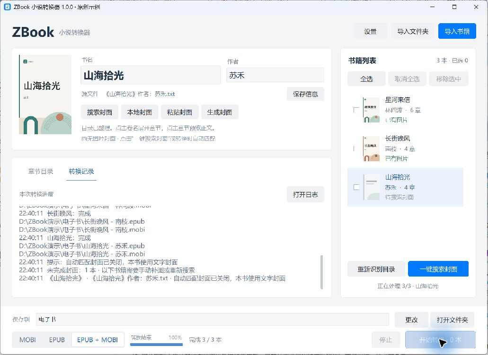

<p align="center">
  
</p>

<h1 align="center">ZBook 小说转换器</h1>

<p align="center">
  <strong>把小说整理好，再放进电纸书。</strong>
</p>

<p align="center">
  自动识别书名、作者、章节与分卷，批量匹配封面，导出 EPUB 和 MOBI。<br />
  从一份 TXT，到一本有封面、有目录、方便阅读的电子书。
</p>

<p align="center">
  <strong>Windows 10 / 11 x64</strong> &nbsp;·&nbsp; <strong>1.0.0</strong> &nbsp;·&nbsp;
  默认 MOBI &nbsp;·&nbsp; 每批最多 50 本
</p>

<p align="center">
  <a href="#项目初衷">为什么做 ZBook</a> &nbsp;·&nbsp;
  <a href="#功能介绍">功能介绍</a> &nbsp;·&nbsp;
  <a href="#快速开始">快速开始</a> &nbsp;·&nbsp;
  <a href="#下载与安装">下载与安装</a> &nbsp;·&nbsp;
  <a href="docs/USER_GUIDE.md">使用指南</a> &nbsp;·&nbsp;
  <a href="https://github.com/huoranxuanyuan/ZBook/issues">反馈问题</a>
</p>

<p align="center">
  
</p>

<p align="center">
  <sub>封面与书籍信息在上方，章节目录是主区域，右侧集中管理书籍。截图使用原创示例内容。</sub>
</p>

## 项目初衷

做 ZBook 的初衷很直接：**把小说放进电纸书之前，少花一些时间整理，多留一些时间阅读。**

分章、制作目录、转换 EPUB 或 MOBI，已经有不少工具可以完成。实际使用时，反复需要处理的还有文件名不规范、作者信息缺失、分卷层级混乱，以及一本一本找封面、下载图片、再添加到书籍里。

这个项目最早来自一个具体需求：原先使用的工具停止维护，联网获取封面的功能也失效了。起初只是想恢复这一环，后来逐渐发现，批量导入、自动识别书名作者、查看每本书的整理结果，同样需要一个清楚、顺手的流程，于是有了 ZBook。

ZBook 把这些步骤放在同一个窗口里：导入后自动识别目录，封面可以单独批量搜索，转换前能直接看到书名、作者、封面和章节。处理失败时，也能找到具体是哪本书、出现了什么问题。

希望它能成为一个可以继续维护的小工具，让整理小说这件事更省心，也让每一次自动处理的结果都方便核对。

## 适合什么场景

- **经常把 TXT 小说放进电纸书阅读**：希望得到带封面、带导航目录的 EPUB 或 MOBI。
- **手里有一批待整理的小说**：需要统一识别书名、作者、章节和封面，再批量转换。
- **在意目录结构**：想先看清分卷和章节，确认识别结果后再导出。
- **不想反复切换工具**：希望导入文档、搜索封面、调整信息和转换格式在一个窗口内完成。

ZBook 面向以文字为主的小说与长篇文档。Word、PDF 导入会提取正文并重新排版；扫描型 PDF 需要先 OCR，复杂版式不保证按原样保留。

## 功能速览

| 功能 | 可以完成的事情 |
| --- | --- |
| 多格式导入 | TXT、DOC、DOCX、RTF、文字型 PDF；支持多选文件、文件夹和右侧列表拖放 |
| 信息识别 | 从文件名和正文信息识别书名、作者，并允许手动核对与修正 |
| 章节与分卷 | 导入时自动分章、识别分卷，按全文 → 分卷 → 章节展示 |
| 批量封面 | 一键搜索全列表的缺失图片封面，自动应用匹配候选，并保留已有图片 |
| 封面核对 | 列表直接展示缩略图，可逐本重新搜索、导入本地图片或粘贴图片 |
| 文字封面 | 根据书名和作者生成现代青绿、暖调暮橙两种大字封面 |
| 批量转换 | 导出 EPUB、MOBI 或双格式；默认 MOBI，同名输出自动编号 |
| 过程与结果 | 显示当前处理书籍、转换阶段、未匹配封面清单及错误日志 |

## 功能介绍

### 1. 批量导入，先把书籍信息整理清楚

点击“导入书籍”可以一次选择多个文件；点击“导入文件夹”可以扫描所选文件夹。文件或文件夹也可以直接拖入**右侧书籍列表**。

导入后，ZBook 会自动整理章节目录，并尝试识别书名和作者。例如下面这种文件名可以明确提供元信息：

```text
《星河来信》作者：林间渡.txt
```

文件名和正文不一定规范，自动识别后仍可直接修改书名、作者，再点击“保存信息”。原文件名会单独显示，便于核对来源。

队列中的书籍可以分别勾选；“全选”“取消全选”“移除选中”是三个独立按钮。移除列表项只影响本次待处理队列。

### 2. 目录优先，分卷和章节一眼看清

章节目录放在主区域，正文作为旁边的辅助预览。有分卷的书籍会按层级组织：

```text
全文
├─ 前言
├─ 第一卷 夜航
│  ├─ 第一章 一封来信
│  ├─ 第二章 河岸的灯
│  └─ 第三章 望向星空
└─ 第二卷 归途
   ├─ 第四章 归来的旅人
   └─ ……
```

- 分卷自动识别，默认折叠到卷名，手动展开后查看章节。
- 点击章节即可预览对应正文，目录和书籍列表支持连续滚动。
- 列表中的“多少章”是章节数，不包含卷名和前言节点。
- 点击书籍列表只切换预览；原文件或识别规则改变后，再显式重新识别。

导出的电子书保留阅读器导航目录，不额外插入一页需要逐页翻过的正文目录。

### 3. 一键搜索封面，也能逐本检查和调整

封面匹配是 ZBook 的重点功能。点击“一键搜索封面”，会处理**列表内全部书籍，包括未勾选的书籍**；已有图片封面保留，为缺少图片的书籍搜索、下载并应用匹配候选中的第一张图片。

处理到哪本书，详情区就会切换到哪本，便于直接查看封面和目录。列表中的缩略图会随结果更新，不必逐本点开才能知道封面是否齐全。


*示例中两本已有图片封面，一本仍待搜索。图片来自本地原创示例，用于展示缩略图和待处理状态，不代表真实网站的检索结果。*

同名作品、不同版本或站点信息不完整，都可能影响匹配。因此，自动选图后仍应结合书名、作者和缩略图核对。需要调整时，选择该书使用：

| 操作 | 用途 |
| --- | --- |
| 搜索封面 | 查看其他候选、修改搜索词，或使用浏览器查找补搜 |
| 本地封面 | 从电脑中选择已经准备好的图片 |
| 粘贴封面 | 直接使用剪贴板中的图片 |
| 生成封面 | 用当前书名和作者生成文字封面 |

图片清晰度取决于来源，低清图片也可以使用。搜索遇到无结果、限流或站点验证时，可以切换其他来源或使用本地、文字封面。

### 4. 没有图片，也能生成适合电纸书的封面

文字封面采用大字书名、清楚的作者信息和简洁的几何图形，提供两种彩色风格。设计同时考虑明暗层次，方便在黑白电纸书上阅读。

<table>
  <tr>
    <td align="center" width="50%">
      <br />
      <strong>现代青绿</strong><br />
      <sub>青绿、米白与暖橙点缀，书名保持清晰醒目。</sub>
    </td>
    <td align="center" width="50%">
      <br />
      <strong>暖调暮橙</strong><br />
      <sub>暖色块与深色文字，适合偏温暖的阅读氛围。</sub>
    </td>
  </tr>
</table>

在设置中选择样式，点击“生成封面”即可使用。明确选择文字封面的书籍，直接转换时会保留这一选择；之后再点击“一键搜索封面”，仍可尝试补充图片。

### 5. EPUB / MOBI 批量导出，默认选择 MOBI

选择保存位置、勾选待转换书籍，再选择输出格式：

| 格式 | 说明 |
| --- | --- |
| MOBI | 默认选项，文件同时包含 MOBI7 与 KF8 内容 |
| EPUB | 生成通用 EPUB 电子书，包含封面和导航目录 |
| EPUB + MOBI | 同一批书籍同时输出两种格式 |

便携版内置 Kindling 编码器，不需要额外安装 Python、Office 或 Calibre。转换在本地完成，同名输出自动增加编号，不覆盖已有电子书。

默认排版使用左对齐章节标题、正文首行缩进和紧凑段落；行距、段距等可以在设置中调整。实际接收格式和显示效果取决于目标阅读器，按设备或阅读软件支持的格式选择即可。

### 6. 过程有进度，未完成的项目有说明

转换记录会显示正在处理哪本书，以及读取分章、封面处理、生成 EPUB、编码 MOBI 等阶段。MOBI 编码耗时较长时，会定时提示已用时。



*这次示例关闭了自动联网补搜，第三本因缺少图片而使用文字封面。记录中明确列出了书名和原因；三本书的 EPUB、MOBI 均已生成。*

批量搜索结束后，未匹配封面的具体书名和原因会汇总显示。转换出现错误时，会保留错误日志；点击“打开日志”可查看相应记录。停止任务后，已经完成的电子书仍会保留。

### 7. 把常用设置集中放在一起

TXT 编码、章节规则、自定义正则、正文行距、段距、文字封面样式和 MOBI 编码器，都可以在设置窗口调整。

<p align="center">
  
</p>

“转换前自动匹配缺失封面”默认开启；关闭后会保存该偏好，手动搜索仍可使用。截图采用离线演示配置，展示了关闭这一选项的状态。

## 三个动作，各做一件事

| 动作 | 整理章节目录 | 联网搜封面 | 处理范围 |
| --- | --- | --- | --- |
| 导入书籍 / 导入文件夹 | 自动进行 | 不主动搜图 | 本批导入的书籍 |
| 重新识别目录 | 重新处理 | 不搜图 | 列表内全部书籍；当前书也可单独重新识别 |
| 一键搜索封面 | 不重新分章 | 搜索缺失图片封面 | 列表内全部书籍，已有图片保留 |

开始转换时，只处理**已勾选**的书籍，并按照设置决定是否补搜缺失封面。这样可以分别检查目录和封面，不必在切换书籍时重复整理。

## 快速开始

**第一步：导入。** 点击右上角的“导入书籍”或“导入文件夹”，也可拖入右侧书籍区域。等待自动目录识别完成。

**第二步：核对。** 检查书名、作者、分卷与章节；需要修改元信息时，编辑后点击“保存信息”。

**第三步：补封面。** 点击“一键搜索封面”，查看右侧缩略图。对不合适的封面，逐本重新搜索或使用本地、剪贴板图片。

**第四步：转换。** 勾选要导出的书籍，选择保存位置与格式，点击“开始转换”。

**第五步：查看结果。** 在转换记录中检查完成情况、未匹配封面清单和错误提示，再打开输出文件夹。

完整操作和排错方法见[使用指南](docs/USER_GUIDE.md)。仓库中的[原创示例文本](examples/novel.txt)可用于试用；文件名与元信息也可以根据需要调整。

## 下载与安装

当前仓库先提供源码、说明和截图的私有预览，安装包将在[发布页](https://github.com/huoranxuanyuan/ZBook/releases)提供。使用便携版时，下载 **`ZBook-1.0.0-Windows-x64.zip`**，完整解压后运行 **`ZBook.exe`**。

| 发布文件 | 内容 |
| --- | --- |
| `ZBook-1.0.0-Windows-x64.zip` | Windows x64 便携软件、说明文档和许可证 |
| `ZBook-1.0.0-source.zip` | 对应项目源码与构建脚本 |
| `ZBook-1.0.0-third-party-sources.zip` | 固定版本的第三方对应源码 |
| `SHA256SUMS.txt` | 发布文件的 SHA-256 校验值 |

当前便携版面向 Windows 10 / 11 x64。程序未做商业代码签名，Windows 可能显示未知发布者提示。需要从源码运行或自行构建时，参阅[构建说明](BUILDING.md)。

## 格式与批量限制

| 项目 | 范围 |
| --- | --- |
| TXT | 支持常见中文编码，也可手动指定编码 |
| Word | `.doc`、`.docx`、`.rtf`，提取文字并重新排版 |
| PDF | 以文字内容为主的 PDF；扫描文档需先 OCR |
| 输出 | EPUB、MOBI、EPUB + MOBI |
| 数量 | 队列最多 50 本，超限时整批拒绝，请减少选择或拆分文件夹 |
| 大小 | 单文件最多 64 MiB，单批总量最多 512 MiB |
| 拖放 | 仅右侧书籍列表及其卡片区域接收文件和文件夹 |

这些限制用于让批量处理保持可控。面对几千本书的文件夹，建议先按批次整理，再逐批导入。

## 本地数据与联网说明

- **正文在本地处理。** 封面检索会向公开书籍、图片站点发送书名、作者及必要的网络请求信息。
- **联网由操作触发。** 导入和重新识别目录不主动搜图；手动搜索、浏览器补搜，以及启用后的转换前补搜会联网。
- **每次打开是新的待处理列表。** 上一次的书籍队列和界面转换记录不自动恢复，输出目录与排版等偏好保留。
- **日志与缓存有保留策略。** 封面、浏览器缓存和任务日志分别管理，正在使用的资源受保护；清理采用回收站，正式输出保留。

数据目录、保留周期、系统代理与浏览器补搜的具体说明，见[使用指南](docs/USER_GUIDE.md#数据与缓存)及[隐私与联网说明](PRIVACY.md)。

## 常见问题

<details>
<summary><strong>导入后为什么没有自动换上图片封面？</strong></summary>

导入负责识别元信息和目录。点击“一键搜索封面”批量搜图，或在转换前启用自动补搜。导入时发现的同目录图片也可以直接作为封面使用。

</details>

<details>
<summary><strong>为什么选中的书有几本，但搜索封面处理了整个列表？</strong></summary>

勾选状态用于决定哪些书参与转换。“一键搜索封面”和“重新识别目录”处理整个列表，让书籍先准备齐全；已有图片封面会保留。

</details>

<details>
<summary><strong>封面匹配不正确，应该怎样调整？</strong></summary>

先检查书名和作者，再对该书重新搜索并选择候选。也可以导入本地图片、粘贴剪贴板图片或生成文字封面。“一键搜索封面”保留已有图片，因此更换错误封面应当逐本操作。

</details>

<details>
<summary><strong>分卷没有识别出来，或把正文误识别了怎么办？</strong></summary>

识别效果取决于原文的标题格式。先核对章节规则，调整后重新识别；目录中的正文预览可以帮助确认边界。分卷由程序自动识别，不提供手动增加分卷入口。报告问题时，提供能够公开的最小文本片段即可。

</details>

<details>
<summary><strong>扫描 PDF、图片小说能直接转换吗？</strong></summary>

需要先用 OCR 工具转换为可提取文字的文档。ZBook 不内置 OCR，复杂 Word 或 PDF 的原始版式也不保证完整还原。

</details>

<details>
<summary><strong>EPUB 和 MOBI 应该选哪个？</strong></summary>

按目标设备或阅读软件接收的格式选择。软件默认 MOBI；需要 EPUB 时可以单独选择，也可以同时导出两种格式。尚未对所有 Kindle 型号和固件进行真机验证。

</details>

## 开发与贡献

欢迎在 [Issues](https://github.com/huoranxuanyuan/ZBook/issues) 提交可复现的问题、封面来源建议和有明确使用场景的改进意见。反馈时请说明版本、输入格式、操作步骤、预期结果和实际结果；附日志前去除私人路径和个人信息，不要上传没有分享权限的小说全文。

| 文档 | 内容 |
| --- | --- |
| [使用指南](docs/USER_GUIDE.md) | 完整操作、缓存说明与常见问题 |
| [构建说明](BUILDING.md) | 源码运行、离线回归、打包与发布校验 |
| [代码结构](docs/ARCHITECTURE.md) | 模块职责、后台任务与界面事件流程 |
| [贡献说明](CONTRIBUTING.md) | 反馈问题、准备最小示例和提交修改 |
| [版本记录](CHANGELOG.md) | 当前版本的功能与修复记录 |

## 作者与许可证

**作者：huoranxuanyuan**

ZBook 原创部分 Copyright (C) 2026 huoranxuanyuan，采用 [GNU AGPL v3 only（AGPL-3.0-only）](LICENSE)。第三方软件、字体和测试素材保留原作者与许可证，详情见[作者声明](AUTHORS.md)、[第三方组件说明](THIRD_PARTY_NOTICES.md)及[第三方源码附件说明](docs/THIRD_PARTY_SOURCES.md)。

软件作者信息与电子书的作者信息分别管理；导入作品的书名、作者和内容以用户核对后的信息为准。

## 展示参考

本页参考了 [OpenLess 的中文介绍](https://github.com/Open-Less/openless/blob/beta/README.zh.md)与 [magpie 的中文介绍](https://github.com/yetone/magpie/blob/main/README.zh-CN.md)的组织方式：清楚的项目定位、分功能配图和中文上手说明。
