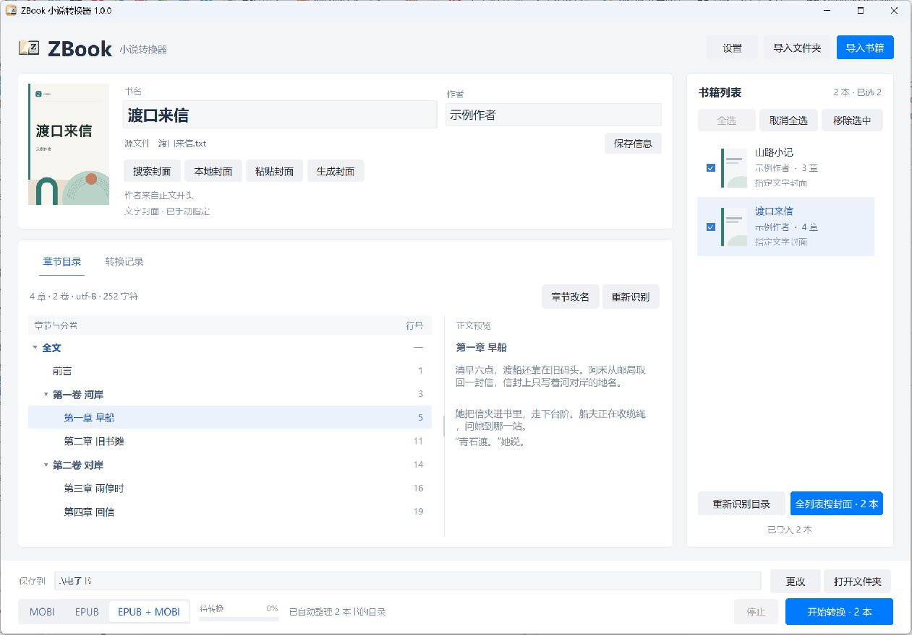

# ZBook 小说转换器

ZBook 1.0.0 可以把 TXT、Word（DOC、DOCX、RTF）和文字型 PDF 小说转成 EPUB 或 MOBI。导入一本书或整个文件夹，软件会自动识别分卷和章节，生成目录。



## 使用方法

1. 在 64 位 Windows 10 或 11 上解压便携版，双击 `ZBook.exe`，把书拖到右侧的书籍列表。
2. 选中一本书，点章节名就能看到正文。遇到漏掉的章节，可以在“设置”里补充识别规则。
3. 核对书名和作者，选好封面、保存位置和格式，点“开始转换”。选 `EPUB + MOBI` 可以一次导出两种格式。

封面可以用本地图片，也可以用书名生成。联网搜封面时，软件会把书名和作者发给搜索服务，小说正文在本机处理。

<details>
<summary>从源码运行和打包</summary>

在 Windows x64 安装带 Tcl/Tk 的 Python 3.14.10，然后在项目目录运行以下命令。

```powershell
py -3.14 -m venv .venv
.\.venv\Scripts\python -m pip install -r tools/requirements.txt
.\.venv\Scripts\python src/app.py
```

需要打包成独立的 Windows 程序时，再运行以下命令。

```powershell
.\.venv\Scripts\python -m pip install -r tools/requirements-build.txt
.\.venv\Scripts\python -m pip download --only-binary=:all: --no-deps -r tools/requirements-build.txt -d .wheels
.\.venv\Scripts\python tools/build_release.py --dist-dir release-output
```

</details>

作者 huoranxuanyuan。[项目许可](LICENSE) · [第三方组件](licenses/THIRD_PARTY_NOTICES.md)
